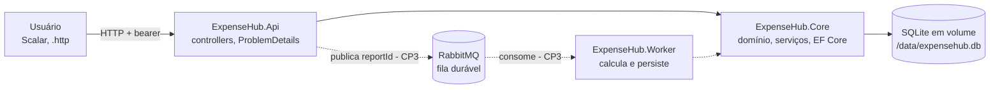

# ExpenseHub

API corporativa de reembolsos em **ASP.NET Core 10**: Identity com bearer, autorização por perfil, proprietário e
estado, histórico auditável e pagamento (CP2), evoluída com **relatórios em segundo plano via RabbitMQ, worker C# e
exportação Excel** (CP3). Tudo roda em containers e todo comando passa pelo `Makefile`.

FIAP — C# Software Development · Professor Rafael Cassiolato · especificação comum nas issues de
[`Racass/checkpoint-csharpracass-expensehub`](https://github.com/Racass/checkpoint-csharpracass-expensehub/issues).

| Integrante | RM | Frente no CP3 |
|---|---|---|
| João Marcelo Furtado Romero | RM555199 | Fundação, CP3-I01, CP3-I03 |
| Matheus Rivera Montovaneli | RM555499 | CP3-I02, CP3-I04 |
| André Nakamatsu Rocha | RM555004 | CP3-I05, CP3-I06 |

> **Documento vivo.** Este README é a única documentação do projeto. Todo PR que muda comportamento, contrato,
> comando ou configuração atualiza este arquivo no mesmo PR. Regras de trabalho: [`AGENTS.md`](AGENTS.md).

## Sumário

1. [Início rápido](#início-rápido)
2. [Arquitetura](#arquitetura)
3. [Comandos](#comandos)
4. [Configuração](#configuração)
5. [API — identidade e administração](#api--identidade-e-administração)
6. [API — reembolsos e histórico](#api--reembolsos-e-histórico)
7. [Relatórios em segundo plano (CP3)](#relatórios-em-segundo-plano-cp3)
8. [Testes, cobertura e qualidade](#testes-cobertura-e-qualidade)
9. [Matriz de testes](#matriz-de-testes)
10. [Integração contínua](#integração-contínua)
11. [Extras](#extras)
12. [Andamento do CP3](#andamento-do-cp3)
13. [Solução de problemas](#solução-de-problemas)
14. [Entregas e referências](#entregas-e-referências)

## Início rápido

Requisitos no host: **git**, **Docker com Compose v2** e **make**. Nenhum SDK .NET ou PowerShell é necessário.

```shell
git clone git@github.com:gh-johnny/fiap-expensehub.git
cd fiap-expensehub
make env      # cria .env com segredos locais aleatórios (ignorado pelo Git)
make up       # constrói as imagens e sobe RabbitMQ + API, aguardando os health checks
make ps       # estado e saúde dos serviços
```

| Endereço | Conteúdo |
|---|---|
| <http://127.0.0.1:5080/docs> | Referência interativa (Scalar) |
| <http://127.0.0.1:5080/openapi/v1.json> | Documento OpenAPI |
| <http://127.0.0.1:5080/health> | Health check |
| <http://127.0.0.1:15672> | Painel do RabbitMQ (usuário e senha em `.env`) |

O Admin inicial usa `SEED_ADMIN_EMAIL` e `SEED_ADMIN_PASSWORD` do `.env`. Para verificar tudo antes de um PR:
`make verify`.

## Arquitetura



| Projeto | Responsabilidade |
|---|---|
| `ExpenseHub.Core` | Modelos, regras de autorização e de estado, contratos, `ExpenseHubDbContext`, migrations e stores EF Core. Compartilhado pela API e pelo worker. |
| `ExpenseHub.Api` | Host HTTP: controllers finos, `ProblemDetails`, auditoria de requisições, OpenAPI/Scalar, seed e migrations no startup. |
| `ExpenseHub.UnitTests` | MSTest sem banco, rede ou broker reais; contém o gate de cobertura. |
| `ExpenseHub.IntegrationTests` | Provas com SQLite real: migrations, seed, constraints, concorrência e rollback. |

Decisões principais:

- **SQLite compartilhado em volume** (`/data`), com `journal_mode=WAL` aplicado pela API ao migrar, para que API e
  worker leiam e escrevam o mesmo arquivo com segurança.
- **Chaves de Data Protection persistidas** em `/data/keys`: os tokens bearer continuam válidos depois de recriar o
  container (verificado com `docker compose up -d --force-recreate api`).
- **Migrations no startup são opt-in** (`Database__ApplyMigrations=true` no Compose). Fora dos containers, use
  `make migration` e `dotnet ef database update`.
- Imagens em versões fixas (`sdk:10.0.402`, `aspnet:10.0.13`, `rabbitmq:4.1.4-management`), usuário não root e
  health check próprio.

## Comandos

Todos os comandos rodam dentro do container `mcr.microsoft.com/dotnet/sdk:10.0.402`, com o usuário do host (arquivos
gerados nunca pertencem ao root) e o cache NuGet em `~/.nuget/packages`. `make help` lista tudo.

| Comando | O que faz |
|---|---|
| `make build` | Restaura e compila com `-warnaserror` |
| `make format` / `make format-fix` | Verifica / aplica formatação e regras de estilo do `.editorconfig` |
| `make quality` | Executa localmente o pipeline de qualidade do professor (`scripts/Invoke-CodeQuality.ps1`) |
| `make test` | Suítes unitária e de integração |
| `make test-unit` / `make test-integration` | Cada suíte isoladamente |
| `make coverage` | Cobertura unitária com gate de **95 % de linhas e branches**; relatório em `artifacts/coverage/report/index.html` |
| `make coverage-integration` | Cobertura informativa da suíte de integração |
| `make demo` | Demonstração HTTP com 104 cenários do CP2 contra uma API e um SQLite descartáveis |
| `make verify` | `build` + `format` + `coverage` + `test-integration` — obrigatório antes de todo PR |
| `make env` | Cria `.env` a partir de `.env.example` com segredos aleatórios |
| `make up` / `make down` | Sobe (com build) / derruba o ambiente; `down` preserva os volumes |
| `make ps` / `make logs [SERVICE=api]` | Estado dos serviços / logs |
| `make restart SERVICE=api` | Reinicia um serviço |
| `make migration NAME=Nome` | Cria uma migration EF Core em `ExpenseHub.Core` |
| `make shell` | Shell interativo no container do SDK |
| `make clean` | Remove `bin/`, `obj/` e `artifacts/` (cache NuGet e volumes preservados) |

## Configuração

`.env` (gerado por `make env`, nunca versionado):

| Variável | Uso |
|---|---|
| `SEED_ADMIN_EMAIL`, `SEED_ADMIN_PASSWORD` | Única conta criada pelo seed (Admin). A senha segue as regras do Identity. |
| `RABBITMQ_USER`, `RABBITMQ_PASSWORD` | Credenciais do broker, usadas por RabbitMQ, API e worker. |
| `API_PORT` | Porta do host para a API (padrão `5080`). |
| `RABBITMQ_MANAGEMENT_PORT` | Porta do host para o painel do RabbitMQ (padrão `15672`). |

Configuração da aplicação (variáveis de ambiente no formato `Secao__Chave`):

| Chave | Padrão | Uso |
|---|---|---|
| `ConnectionStrings__ExpenseHub` | `Data Source=/data/expensehub.db` na imagem | Banco SQLite |
| `Database__ApplyMigrations` | `false` (`true` no Compose) | Aplica migrations e ativa WAL no startup |
| `DataProtection__KeysPath` | `/data/keys` na imagem | Persistência das chaves que protegem os tokens |
| `Seed__AdminEmail`, `Seed__AdminPassword` | — | Admin inicial (obrigatórios no primeiro startup) |
| `RabbitMq__Host`, `RabbitMq__Port`, `RabbitMq__VirtualHost` | `localhost`, `5672`, `/` (`rabbitmq` no Compose) | Broker |
| `RabbitMq__UserName`, `RabbitMq__Password` | — (vêm do `.env` no Compose) | Credenciais do broker |
| `RabbitMq__ReportQueue` | `expensehub.reports.requested` | Fila quorum durável das solicitações |
| `RabbitMq__PublishTimeout` | `00:00:05` | Espera máxima pela confirmação antes do 503 |
| `ASPNETCORE_ENVIRONMENT` | `Development` no Compose | Habilita `/docs` e `/openapi/v1.json` |

## API — identidade e administração

- `POST /register` recebe `email` e `password` e cria a conta **sem roles**; um campo extra de role é ignorado.
- `POST /login?useCookies=false` devolve `accessToken` e `refreshToken` nativos do Identity (opacos, não JWT). Use
  `Authorization: Bearer <accessToken>` nas rotas protegidas.
- Roles: `Admin`, `Employee`, `Approver`, `Finance`, `Auditor`. O seed cria só o Admin inicial, de forma idempotente.
- `GET /api/admin/users` lista contas e roles (somente Admin).
- `PUT /api/admin/users/{id}/roles` substitui o conjunto de roles numa transação e retorna 204. Role desconhecida
  retorna 400; remover o próprio Admin retorna 403; conta inexistente retorna 404. Depois de mudar roles, o usuário
  faz login de novo.

## API — reembolsos e histórico

Criar e editar recebem apenas `description` (10–500 caracteres, com trim), `amount` (`decimal`, de 0,01 a
2.147.483.647) e `expenseDate` (`yyyy-MM-dd`, nunca futura no calendário UTC do servidor). Proprietário, IDs, estado,
atores e instantes são definidos pelo servidor.

| Operação | Perfil e condição |
|---|---|
| `POST /api/expenses` | Employee; cria `Draft`; 201 com `Location` |
| `PUT /api/expenses/{id}` | Employee proprietário; somente `Draft` |
| `POST /api/expenses/{id}/submit` | Employee proprietário; `Draft → Submitted` |
| `POST /api/expenses/{id}/approve` | Approver não proprietário; `Submitted → Approved` |
| `POST /api/expenses/{id}/reject` | Approver não proprietário; `Submitted → Rejected`; `reason` com 10–500 caracteres |
| `POST /api/expenses/{id}/pay` | Finance não proprietário; `Approved → Paid` |
| `GET /api/expenses`, `/{id}`, `/{id}/history` | União dos escopos de leitura abaixo |

Leitura: Employee vê as próprias despesas; Approver vê `Submitted`; Finance vê `Approved` e `Paid`; Auditor vê todas;
Admin sozinho não tem acesso a despesas. Roles se somam, mas ninguém aprova, reprova ou paga a própria despesa.
O filtro de visibilidade é aplicado na consulta SQL, antes de materializar dados.

O histórico registra criação, edições efetivas e transições, com revisão crescente, ator e instante UTC; edição
idêntica retorna 200 sem novo evento. `Paid` e `Rejected` são finais; repetir uma transição retorna 409. Estado,
evento e pagamento são gravados no mesmo `SaveChanges`, e índices únicos protegem histórico por revisão e pagamento
por despesa.

Erros usam `ProblemDetails` com `code` estável e `traceId` (o mesmo registrado no log de auditoria): 400 entrada
inválida, 401 sem credencial, 403 sem permissão, 404 ausente ou fora do escopo de leitura, 409 estado incompatível ou
concorrência, 500 falha inesperada sem detalhes internos.

Chamadas manuais: [`sources/ExpenseHub.Api/ExpenseHub.Api.http`](sources/ExpenseHub.Api/ExpenseHub.Api.http) (REST
Client do VS Code). Os valores vêm do ambiente do editor (`EXPENSEHUB_BASE_URL`, `Seed__AdminEmail`,
`Seed__AdminPassword`, `EXPENSEHUB_ACCOUNT_*`, `EXPENSEHUB_*_EMAIL`, `EXPENSEHUB_EXPENSE_DATE` e, para relatórios,
`EXPENSEHUB_REPORT_FROM`/`EXPENSEHUB_REPORT_TO`), sem tokens ou senhas no arquivo. Ordem: cadastrar cada perfil,
conceder a role como Admin, fazer os logins nomeados e seguir o fluxo criar → editar → enviar → aprovar → pagar →
histórico → relatório → detalhe → Excel.

## Relatórios em segundo plano (CP3)

Resumo de reembolsos por período, solicitado sem esperar o cálculo: a API **registra e publica**, o worker
**consome, calcula e persiste**, e o usuário **acompanha e baixa** o resultado em Excel. Sem interface nova: use o
Scalar (`/docs`) ou o arquivo `.http`.

| Rota | Comportamento |
|---|---|
| `POST /api/reports` | Valida e grava a solicitação `Pending`, publica `{"reportId"}` e responde **202** com `Location: /api/reports/{id}` somente depois da confirmação do broker. |
| `GET /api/reports` | Lista só as solicitações criadas pelo usuário autenticado, mais recentes primeiro. |
| `GET /api/reports/{id}` | Andamento e resultado persistido de uma solicitação própria (200), sem recalcular. |
| `GET /api/reports/{id}/excel` | `.xlsx` real do resultado persistido de uma solicitação própria `Completed`. |

```json
{ "fromDate": "2026-09-01", "toDate": "2026-09-30", "scope": "Mine" }
```

- Datas `yyyy-MM-dd`, obrigatórias, com `fromDate <= toDate`. O filtro usa `ExpenseDate` com os dois limites
  **inclusivos**, nunca a data de criação.
- `scope`: `Mine` ou `Global` (sem diferenciar maiúsculas; valores numéricos como `"1"` são rejeitados). O
  solicitante vem **só do token**: não existe `ownerId` no contrato.
- Cada POST válido cria uma solicitação nova; não há deduplicação de cliente.

Envelope (todas as rotas; instantes em UTC):

```json
{
  "id": "…", "scope": "Mine", "fromDate": "2026-09-01", "toDate": "2026-09-30", "status": "Pending",
  "createdAt": "…Z", "startedAt": null, "completedAt": null, "result": null, "error": null
}
```

| Estado | Campos |
|---|---|
| `Pending` | `createdAt` preenchido; sem resultado |
| `Processing` | `startedAt` preenchido; sem resultado |
| `Completed` | `completedAt` e `result` preenchidos; `error` nulo |
| `Failed` | `completedAt` e `error` (`code` estável + `message` sanitizada) preenchidos; `result` nulo |

`result` traz `generatedAt`, `totalCount`, `totalAmount` e `byStatus` com **os cinco estados sempre presentes**
(`Draft`, `Submitted`, `Approved`, `Rejected`, `Paid`), inclusive zerados. Somas em `decimal`, exatas. O resultado
é gravado como JSON na própria solicitação (`ReportRequests.ResultJson`); consultas e o Excel leem esse registro e
nunca recalculam, então alterar um reembolso depois da conclusão não muda o relatório salvo.

**Excel:** `Content-Type: application/vnd.openxmlformats-officedocument.spreadsheetml.sheet`,
`Content-Disposition: attachment; filename=report-{id}.xlsx`. A planilha `Report` traz identificador, escopo,
período, instante de geração e a tabela `Status | Count | Amount` com os cinco estados e o total geral, em células
numéricas. Gerada com ClosedXML (MIT) a partir do resultado persistido, sem nova mensagem na fila.

| Cenário | Resposta |
|---|---|
| Sem autenticação | 401 |
| Datas ausentes, inválidas ou invertidas; escopo inválido | 400 (`report.invalid_period` / `report.invalid_scope`), nada é gravado nem publicado |
| Detalhe ou Excel inexistente ou de outro usuário | 404 (`report.not_found`) |
| Excel de solicitação própria `Pending`, `Processing` ou `Failed` | 409 (`report.not_completed`) |
| Gravada e publicação confirmada | 202 + `Location` |
| Banco indisponível antes de gravar | Erro explícito (500 sanitizado), sem 202 e sem identificador |
| Gravada, mas publicação sem confirmação (broker fora, nack, timeout) | **503** `report.publish_unconfirmed` com o `reportId` persistido; a solicitação continua `Pending` |

**Mensageria (publicação):** fila `expensehub.reports.requested`, **durável do tipo quorum**, declarada de forma
idempotente pela API e pelo worker. Mensagens **persistentes** e `mandatory`, publicadas num canal com **publisher
confirms**: o 202 só sai depois do ack do broker. A espera é limitada por `RabbitMq__PublishTimeout` (padrão 5 s),
inclusive quando o broker está fora e a resolução de nome trava. Corpo mínimo `{"reportId":"…"}`, com
`MessageId`/`CorrelationId` iguais ao id. A conexão é única por processo, criada no primeiro uso e com recuperação
automática.

**Janela sem Transactional Outbox:** gravar e publicar são operações distintas. Se o processo cair entre as duas, ou
se a confirmação se perder, a solicitação fica `Pending` sem mensagem garantida. A API responde 503 com o id, o
registro é preservado e um novo POST cria outra solicitação. Reiniciar o worker **não** recupera uma mensagem que
nunca foi publicada. Republicação automática e entrega exatamente uma vez estão fora do escopo.

Verificado no Compose: anônimo → 401; período invertido, data inválida e `scope: "1"` → 400; POST válido → 202 com
`Location` e uma mensagem `Ready` na fila quorum; detalhe e Excel de outro usuário → 404; Excel `Pending` → 409;
broker parado → 503 com `reportId` em ~5 s; broker de volta → 202 de novo, sem reiniciar a API.

> O processamento (worker, confirmação de consumo, idempotência e falhas) chega com CP3-I03; a matriz de
> perfil × escopo (`Mine` para Employee, `Global` para Auditor) chega com CP3-I02. Ver [andamento](#andamento-do-cp3).

## Testes, cobertura e qualidade

| Suíte | Conteúdo | Comando |
|---|---|---|
| Unitária (`ExpenseHub.UnitTests`) | Regras de estado e autorização, validações, histórico, administração, adaptadores HTTP (controllers, ProblemDetails, auditoria) e contrato OpenAPI via `TestServer` em memória. Sem banco, rede ou broker. | `make test-unit` |
| Integração (`ExpenseHub.IntegrationTests`) | SQLite real com migrations: seed idempotente, constraints, escopo SQL, concorrência entre contextos, rollback de roles, histórico e pagamento. | `make test-integration` |
| HTTP (`scripts/Invoke-ExpenseHubVerification.ps1`) | 104 cenários contra a API real em SQLite descartável; relatórios sanitizados em `artifacts/demo/`. | `make demo` |

**Gate de cobertura unitária:** ≥ 95 % de linhas **e** de branches no total da solução (`make coverage`; o build
falha abaixo disso). Estado atual: **100 % de linhas e 96,7 % de branches** (Core: 100 % / 100 %), com 194 testes
unitários e 12 de integração. As exclusões
ficam declaradas só em `ExpenseHub.UnitTests.csproj`: migrations, código gerado, `Program.cs` (composition root,
exercitado pelos smoke tests nos containers) e adaptadores de I/O real (`ExpenseHub.Core.Persistence`, RabbitMQ),
cobertos pela suíte de integração. Métodos `async` **não** são excluídos.

**Qualidade:** `make quality` executa o mesmo script do workflow oficial `code-quality` (score atual 100/100). O
workflow, `Directory.Build.props`, `.editorconfig` e os analisadores do professor não são alterados. O build local e
o CI usam `-warnaserror`.

## Matriz de testes

Cada requisito aponta para os testes que o comprovam. Linhas novas entram no mesmo PR da funcionalidade.

| Requisito | Regra verificada | Unitário | Integração | HTTP (demo) |
|---|---|---|---|---|
| Identidade | Ator vem do token; roles desconhecidas são descartadas; sem identificador → 401 | `Administration/CurrentActorTests`, `Expenses/ContractEdgeTests` | — | Cadastro e login |
| Seed | Somente o Admin, idempotente, senha externa | — | `IdentityPersistenceTests` | Admin inicial |
| Administração | Só Admin; roles conhecidas; não remove o próprio Admin; substituição atômica | `Administration/UserRoleServiceTests`, `Api/AdminUsersControllerTests` | `IdentityPersistenceTests` (rollback) | Atribuição e novo login |
| Rascunho | Campos do servidor, limites de descrição, valor e data, normalização, só o dono edita `Draft` | `Expenses/DraftTests`, `Expenses/ContractEdgeTests` | `RelationalExpenseTests` (round-trip, rollback da criação) | Draft válido e inválido |
| Envio e leitura | `Draft → Submitted`; visibilidade por perfil; 404 fora do escopo | `Expenses/SubmissionTests` | `RelationalExpenseTests` (escopo SQL) | Isolamento entre perfis |
| Matriz de autorização | Todas as uniões de roles × estados; Admin sem acesso implícito | `Expenses/AuthorizationMatrixTests` | — | Conta com todas as roles |
| Decisões | Aprovar/reprovar, justificativa, sem autoaprovação, repetição → 409 | `Expenses/DecisionTests` | — | Fluxos aprovado e reprovado |
| Pagamento e histórico | Pagamento único, ator e UTC do servidor, histórico ordenado e visível | `Expenses/PaymentHistoryTests` | `RelationalExpenseTests` (unicidade, rollback) | Fluxo até `Paid` |
| Concorrência | Revisão como token; decisão obsoleta e pagamento duplicado → 409 sem efeito parcial | — | `RelationalExpenseTests` (`TwoContextsRejectAStaleDecision`, `DuplicatePaymentIsAConflictWithoutAnotherRecord`) | — |
| Contrato HTTP | Status por rota, `Location`, ProblemDetails com `code`/`traceId`, 500 sanitizado | `Api/ExpensesControllerTests`, `Api/ApiExceptionHandlerTests` | — | Todas as 13 rotas |
| Auditoria | Log por requisição com método, rota, recurso, ator, `traceId` e status real | `Api/RequestAuditMiddlewareTests` | — | — |
| OpenAPI | Bearer, tags, status documentados, exemplos, enum de estados, `decimal` | `Api/OpenApiDocumentTests` | — | Contrato OpenAPI |
| Relatório — cálculo | Exemplo do professor (Mine 3 / R$ 175,00; Global 4 / R$ 375,00), limites inclusivos, Mine sem outros donos, cinco estados zerados, somas `decimal` exatas | `Reports/ReportCalculatorTests` | `RelationalReportTests` (mesmo filtro traduzido para SQL) | — |
| Relatório — solicitação | Grava `Pending` com solicitante do token e publica uma vez; escopos válidos e inválidos (inclusive `"1"`); período invertido ou ausente → 400 sem gravar nem publicar; dia único válido; cada POST cria outro id | `Reports/ReportServiceTests` | `RelationalReportTests` (constraints de período e FK) | — |
| Relatório — publicação | Sem confirmação → 503 com `reportId` persistido e `Pending`; banco fora antes de gravar → erro sem publicar; extensões no ProblemDetails | `Reports/ReportServiceTests`, `Api/ApiExceptionHandlerTests` | — | — |
| Relatório — leitura | Lista só os próprios, mais recentes primeiro; detalhe alheio → 404; resultado persistido sem recálculo; erro sanitizado em `Failed` | `Reports/ReportServiceTests`, `Reports/ReportContractTests` | `RelationalReportTests` (consultas por dono em SQL, UTC) | — |
| Relatório — Excel | `.xlsx` real (ZIP), metadados, cinco estados e total em células numéricas iguais ao resultado salvo; vazio com zeros; 409 fora de `Completed`; 404 alheio; nome `report-{id}.xlsx` | `Reports/ReportWorkbookTests`, `Reports/ReportServiceTests`, `Api/ReportsControllerTests` | — | — |
| Mensagem | Corpo só com `reportId`; JSON inválido, vazio ou id zero rejeitados; campos extras (ex.: `ownerId`) ignorados | `Reports/ReportRequestedMessageTests` | — | — |
| Contrato HTTP de relatórios | 202 + `Location`, 503/409 documentados no OpenAPI, exemplos de corpo | `Api/ReportsControllerTests`, `Api/OpenApiDocumentTests` | — | — |

Execução em matriz no CI: cada suíte roda em **Ubuntu, Windows e macOS** (ver abaixo).

## Integração contínua

| Workflow | Jobs |
|---|---|
| `code-quality` (`build.yml`, do professor, inalterado) | Build, Gitleaks e score de qualidade |
| `ci` (`ci.yml`) | `make verify` no Ubuntu (gate de cobertura + resumo no job); matriz `{Unit, Integration} × {Ubuntu, Windows, macOS}`; build das imagens |
| `expensehub-demo` (`demo.yml`) | Build, testes e os 104 cenários HTTP, com relatório como artefato |

## Extras

Além do exigido, sempre com um extra por entrega:

| Extra | Onde |
|---|---|
| Ambiente 100 % containerizado com `Makefile` (host só com git, Docker e make) | `Makefile`, `compose.yaml` |
| Gate de cobertura unitária de 95 % (linhas e branches) com relatório HTML | `make coverage` |
| Matriz de testes por requisito e matriz de SO no CI | [Matriz de testes](#matriz-de-testes), `ci.yml` |
| Referência interativa Scalar e contrato OpenAPI testado | `/docs`, `Api/OpenApiDocumentTests` |
| Demonstração HTTP automatizada (104 cenários) com relatórios sanitizados | `make demo` |
| Provas relacionais em SQLite real (constraints, concorrência, rollback) | `ExpenseHub.IntegrationTests` |
| Tokens preservados entre recriações (Data Protection em volume) e SQLite em WAL | `Program.cs`, `DatabaseInitializer` |
| Segredos locais gerados automaticamente | `make env` |
| Fila quorum, check constraints de estado, escopo e período no banco, e publicação com tempo máximo mesmo com o broker fora | `RabbitMqReportPublisher`, migration `AddReportRequests` |
| Exemplo do professor reproduzido em teste unitário **e** em SQL real | `ReportCalculatorTests`, `RelationalReportTests` |

## Andamento do CP3

| Issue | Frente | Responsável | Estado |
|---|---|---|---|
| Fundação | Core compartilhado, containers, Makefile, cobertura, CI em matriz | João | Concluída (PR #2) |
| [CP3-I01](https://github.com/Racass/checkpoint-csharpracass-expensehub/issues/11) | Contrato, cálculo, persistência, Excel e publicação confirmada | João | Concluída neste PR |
| [CP3-I03](https://github.com/Racass/checkpoint-csharpracass-expensehub/issues/13) | RabbitMQ, worker e idempotência | João | Planejada |
| [CP3-I02](https://github.com/Racass/checkpoint-csharpracass-expensehub/issues/12) | Autorização e isolamento | Matheus | Planejada |
| [CP3-I04](https://github.com/Racass/checkpoint-csharpracass-expensehub/issues/14) | Testes próprios significativos | Matheus | Planejada |
| [CP3-I05](https://github.com/Racass/checkpoint-csharpracass-expensehub/issues/15) | Imagens publicadas e Compose reproduzível | André | Planejada |
| [CP3-I06](https://github.com/Racass/checkpoint-csharpracass-expensehub/issues/16) | Experimentos E01–E05 e diagnóstico | André | Planejada |
| [CP3-I07](https://github.com/Racass/checkpoint-csharpracass-expensehub/issues/17) | Qualidade das alterações | Todos | Contínua (`make verify`, `make quality`) |

## Solução de problemas

| Sintoma | Causa e correção |
|---|---|
| `all predefined address pools have been fully subnetted` no `make up` | O Docker do host esgotou as faixas de rede. Remova redes sem uso (`docker network prune`) ou crie um `compose.override.yaml` local (já ignorado pelo Git) fixando uma subnet livre em `networks.default.ipam.config`. |
| `port is already allocated` | Outra aplicação usa a porta. Ajuste `API_PORT` ou `RABBITMQ_MANAGEMENT_PORT` no `.env`. |
| `set SEED_ADMIN_EMAIL in .env` ao subir | O `.env` não existe ou está incompleto: rode `make env`. |
| `make quality` local com FIAP2102 em `.env` | O script também varre arquivos locais não versionados; o `.env` real (ignorado pelo Git) tem senhas. No CI ele não existe e o score é 100. |
| Token deixou de valer | Mudança de roles exige novo login. Se os volumes foram removidos, as chaves e o banco foram recriados. |

## Entregas e referências

- **CP2:** implementação integrada pelo PR #1 deste repositório e marcada pela tag `cp2-final`, que é o commit base
  evoluído pelo CP3. Issues cobertas: Racass/checkpoint-csharpracass-expensehub#1 a #10.
- **CP3:** o commit final é registrado aqui quando a última frente for integrada.
- Documentos do professor herdados do template: [enunciado](docs/ENUNCIADO.md), [requisitos](docs/REQUISITOS.md),
  [matriz de autorização](docs/MATRIZ-AUTORIZACAO.md), [rubrica](docs/RUBRICA.md),
  [processo GitHub](docs/PROCESSO-GITHUB.md), [uso de IA](docs/USO-DE-IA.md),
  [regras de qualidade](docs/code-quality-rules.md).
- Fluxo de contribuição, convenções e condições do projeto: [`AGENTS.md`](AGENTS.md).
